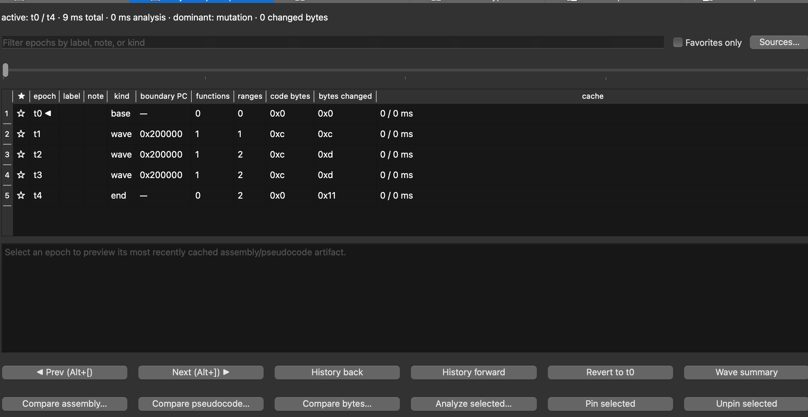
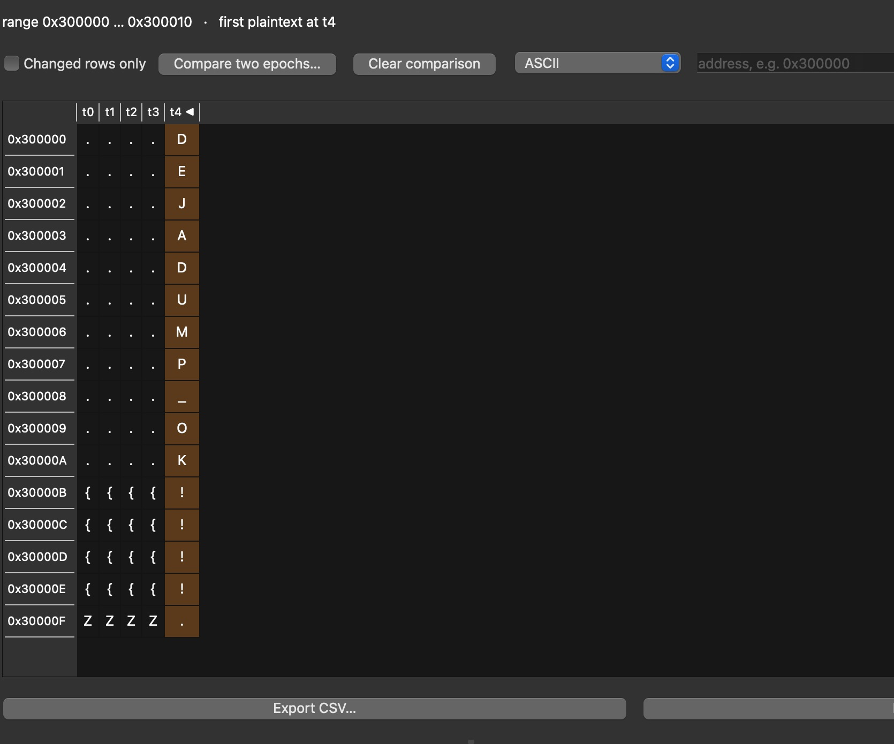
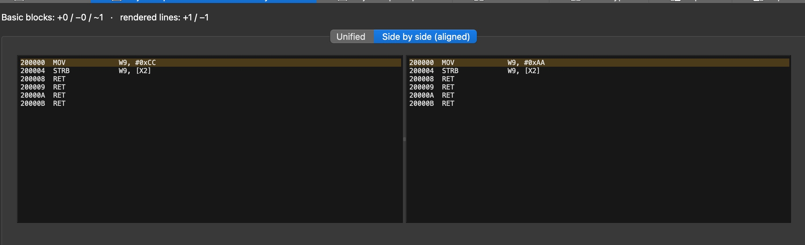

# DéjàDump

**A time axis for the IDA database: versioned code, versioned data, one IDB.**

IDA's address space is single-valued — one byte, one item, one function per
address. Packers, staged loaders and self-modifying code (SMC) break that
assumption: the same region is overwritten several times, and the data that
drives control flow changes as execution proceeds. DéjàDump adds **epochs**
(execution "waves") as a first-class dimension of the IDB, so every observed
version of a region is kept — deduplicated, with provenance — and each one is
analysable with *unmodified* IDA machinery: auto-analysis, xrefs, functions,
types, names, and Hex-Rays pseudocode.

> **What DéjàDump combines.** Earlier research loaded unpacker waves into one IDB
> (*Malware Lineage in the Wild*, 2017; RePEconstruct, 2016), and *CoDisasm*
> (CCS 2015) formalised wave semantics. DéjàDump brings interactive per-epoch
> Hex-Rays pseudocode, a swap-in-place time slider at the *canonical* address
> with scoped re-analysis and decompiler-cache invalidation, and per-address
> write history into one database. See [prior art](docs/PRIOR_ART.md) for the
> dated plugin index scan.

> ⚠️ **Status: pre-release (0.4).** Implemented: the pure-Python engine (store,
> byte-granular wave detection, Tenet/Frinet import with rebasing and filtering,
> read-through state, observed reads, search), the **Mode A time-slider** with
> per-epoch annotations, **pins (Mode B)**, assembly/pseudocode/byte **diffs**
> with optional idalib workers, **image-pair / memory-dump / debugger-snapshot**
> capture, the **Memory Timeline**, **Write History**, **wave summaries** and a
> headless CLI — on a self-built **ARM64 + x86-64** corpus. Headless parts are
> unit-tested; the in-IDA parts are exercised by `tools/smoke_mode_a.py`.
> Walk through everything in [docs/DEMO.md](docs/DEMO.md); every menu item is
> explained in the [User Guide](docs/USER_GUIDE.md).

---

## See it in IDA

Import a trace, then use the Epoch Timeline to switch between the original image
(`t0`), three rewritten code waves (`t1`–`t3`), and the final data state (`t4`).
The same address is re-analysed in IDA for each active epoch.



The Memory Timeline shows the 16-byte data range across all five epochs. Reading
down the t4 column in ASCII reveals `DEJADUMP_OK!!!!`; the earlier columns remain
encrypted.



Compare two epochs as assembly or Hex-Rays pseudocode. The aligned assembly view
below shows the instruction at `0x200000` changing from `0xCC` in `t3` to `0xAA`
in `t1`; [the demo](docs/DEMO.md#9-compare-versions) also shows the unified and
pseudocode views.



## How it works

1. **Capture** memory over time — from a **Tenet / Frinet** execution trace, a
   before/after **image pair**, raw **memory dumps**, or **snapshots** taken in
   IDA's debugger. Traces are split into epochs at **wave boundaries**: a new
   epoch begins when an executed instruction's bytes intersect memory written
   since the last boundary (byte-granular, after CoDisasm; a page pre-filter keeps
   it cheap). Writes outside the IDB are filtered and the trace is rebased onto it.
2. **Store** every epoch in a SQLite sidecar (`<idb>.dejadump.db`) with a
   content-addressed blob table (identical stage bytes cost one row) and a netnode
   index that ties the sidecar to the IDB.
3. **Browse** with a time-slider that swaps an epoch's bytes into the
   canonical address space and re-runs analysis + the decompiler; a Memory
   Timeline (one column per epoch) showing data decrypt over time; and a
   per-address write history with the writer PC.

## Features

- **Time slider (Mode A)** — swap any epoch into the canonical address space; real
  IDA analysis, xrefs and Hex-Rays pseudocode per version; `Alt+[` / `Alt+]`;
  journaled, verified and rolled back on failure.
- **Per-epoch annotations** — names, comments, types, operand formats, function
  details and Hex-Rays variables belong to the epoch they were made in (and can be
  promoted to all epochs).
- **Wave summary & changed-line highlighting** — what each wave added, removed or
  rewrote (functions, ranges, revealed strings), and the changed lines lit up in
  the listing without touching IDB colours.
- **Assembly and pseudocode diff** — cached, normalized unified comparison between
  any two epochs, raw-byte mode, line navigation, and a live-IDB fallback when
  idalib is unavailable.
- **Pinned epochs (Mode B)** — selected AArch64/x86-64 epochs in persistent sparse
  shadow segments for native side-by-side navigation and one-time analysis.
- **Memory Timeline** — one column per epoch, changed-row and A/B filters, address
  search, typed integer/ASCII rendering, a "first-plaintext" marker,
  CSV/Markdown export, double-click → writer.
- **Write History & temporal xrefs** — every write attributed to the instruction
  that performed it; cross-reference one location across every epoch it changed.
- **Search & export** — search every epoch for bytes or strings without switching;
  write any epoch back into a copy of the input file (a shareable unpacked binary).
- **Bring your own capture** — works with established tracers and dumpers (Tenet's
  Pin/QEMU tracers, Frinet, TTD via ttd-bindings, GDB, LLDB, Frida, pe-sieve,
  x64dbg, `/proc/<pid>/mem`, IDA's debugger); see the
  [User Guide](docs/USER_GUIDE.md#6-getting-traces-and-dumps).
- **Volatile-region decoration** — the disassembly is banner-marked with
  the active epoch, so the time dimension is visible in the view itself.
- **Architecture-agnostic** — ARM64 and x86-64, same model, same handling.
- **Headless engine & CLI** — pure Python, stdlib-only, unit-tested;
  `python -m dejadump import|dumps|info|export|compact` for large inputs.

## How it compares

| Tool | Through time? | Re-disassembles overwritten code per version? | Per-version pseudocode? | Shipped plugin? |
|---|---|---|---|---|
| Tenet / Frinet | yes (trace seek) | no | no | yes |
| ttddbg | yes (TTD) | no | no | yes |
| Ghidra debugger trace DB | yes | per snapshot, read-only; markup vanishes stepping back | no | (Ghidra) |
| Malware Lineage / RePEconstruct | one-shot static load | relocates waves into one IDB | no | no (research) |
| **DéjàDump** | **yes (epochs)** | **yes, in place, with scoped re-analysis** | **yes** | **yes** |

## Install

DéjàDump targets **IDA 9.4 / 9.5** (IDAPython 3; PySide6). Once published:

```
hcli plugin install dejadump
```

For background comparisons, open **Edit → DejaDump → Settings…** and pick a
Python interpreter that can `import idapro` (idalib); the pool size is 1–4
(default 2). The `DEJADUMP_IDALIB_PYTHON` / `DEJADUMP_WORKERS` environment
variables still override the saved values. Without a worker, comparison uses the
transactional live-IDB fallback and restores the originally active epoch.

During development, clone the repo and point IDA's plugin path at it (the repo
root is the plugin root: `ida-plugin.json` + `dejadump_plugin.py` + the
`dejadump/` package).

## Quick start (engine, headless)

```
python -m dejadump import trace.tenet --sidecar target.dejadump.db --elf target.so
python -m dejadump info --sidecar target.dejadump.db
```

```python
from dejadump.core.store import EpochStore
from dejadump.core import tenet

store = EpochStore("sample.dejadump.db", fast_import=True)
tenet.import_trace_file("trace.tenet", store, arch=tenet.ARM64,
                        keep=[(0x0, 0x6f0000)])   # optional: only the module's range
for e in store.epochs():
    print(e["seq"], e["boundary_kind"])
```

Generate the ARM64 self-modifying-code corpus fixture (needs `unicorn>=2.1`):

```
python -m tools.mkcorpus --outdir tests/fixtures
```

## Develop & test

```
python -m venv .venv && . .venv/bin/activate
pip install -e ".[dev]"
pytest
```

The engine has **no runtime dependencies beyond the Python standard library**;
Unicorn is only used by the corpus generator and is import-guarded.

## Limitations (current)

- **ARM64 and x86-64** are supported and tested (pins: AArch64/x86-64 only). Tenet
  ships arch files for x86/amd64 only, so the ARM64 ingest uses DéjàDump's own
  arch mapping and consumes Frinet's extensions (`slide=` header, `.modules`).
- x86 wave detection checks the first byte of each executed instruction: a rewrite
  of only an instruction's later bytes (e.g. a patched immediate) joins the next
  boundary instead of starting its own.
- Observed reads (`mr=`) feed the data views only; Mode A never writes them into
  the IDB.
- Background workers require a separately configured idalib Python runtime; the
  live transactional path is the fallback. Debugger snapshots are held in memory
  until imported.
- The GUI targets IDA Pro 9.4/9.5 or IDA Home 9.4+; never IDA Free. The ARM64
  decompiler is optional (used for per-epoch pseudocode).

## Documentation

- [docs/USER_GUIDE.md](docs/USER_GUIDE.md) — every feature, menu item, panel and setting
- [docs/DEMO.md](docs/DEMO.md) — a guided run through the main features (both architectures)
- [docs/DESIGN.md](docs/DESIGN.md) — architecture and how it relates to prior work
- [docs/FORMATS.md](docs/FORMATS.md) — trace subset, manifest, sidecar schema
- [CHANGELOG.md](CHANGELOG.md)

## Credits & prior art

- *CoDisasm* — Bonfante, Fernandez, Marion, Rouxel, Sabatier & Thierry (CCS 2015,
  DOI 10.1145/2810103.2813627) — wave semantics.
- *Malware Lineage in the Wild* — Ul Haq, Chica, Caballero & Jha (arXiv:1710.05202)
  — waves loaded into one IDB.
- *RePEconstruct* — Korczynski (MALWARE 2016); *Minerva* (arXiv:1908.09204).
- Tenet (2021) and Frinet (Synacktiv) for the trace format; Ghidra's debugger trace
  model for the read-through / stale-region UX.

## License

MIT — see [LICENSE](LICENSE).
