# DejaDump — Demo

This is one guided run through the main features, using only the self-built corpus
committed in `tests/fixtures`. It contains two self-modifying stubs, one **ARM64**
and one **x86-64**. Each overwrites a code buffer three times and then decrypts a
data table in place. Each step names the action and hotkey and says what you should
see. The screenshots below were taken in IDA Pro 9.5 with the ARM64 fixture.
For what each action does in detail, see the [User Guide](USER_GUIDE.md).

| Corpus address | Contents |
|---|---|
| `CODE` `0x100000` | the mutator and the decryptor (stable code) |
| `BUF` `0x200000` | a stub rewritten at t1, t2 and t3 |
| `DATA` `0x300000` | a 16-byte table, ciphertext until it becomes `DEJADUMP_OK!!!!` at t4 |

---

## 0. Setup (2 minutes)

1. **Requirements:**
   - IDA Pro 9.4 or 9.5, or IDA Home 9.4+.
   - The ARM64 Hex-Rays decompiler is optional. It shows the pseudocode changing per
     epoch.
2. **Headless checks** (no IDA needed):
   ```
   python -m venv .venv && . .venv/bin/activate
   pip install -e ".[dev]"
   pytest                                  # every test passes; 2 Unicorn tests skip on Python 3.14
   python tools/bench_import.py 1000000    # import throughput + the scattered-write case
   ```
   - The corpus is committed. To regenerate it: `python -m tools.mkcorpus --outdir tests/fixtures`.
3. **Install the plugin:**
   - Link `dejadump_plugin.py` into IDA's user plugin directory, or install it with
     `hcli plugin install dejadump`.
   - Restart IDA. The Output window shows `DejaDump 0.4.0 loaded`, and a
     **DejaDump** toolbar and an **Edit → DejaDump** menu appear.
   - Without installing, you can run **File → Script file… →
     `tools/setup_demo_idb.py`** in the opened database instead.
4. **Optional:** **Edit → DejaDump → Settings…** → set *Python interpreter with
   idalib*, then press **Test interpreter**. Comparisons then render in background
   workers.

## 1. Open the target

Open **`tests/fixtures/arm64_smc.elf`** and accept the defaults. IDA detects
AArch64 and creates the three segments. Before anything is imported, every
DéjàDump action except the importers, Settings and Status is greyed out.

## 2. Import a trace — `Ctrl-Shift-T`

1. **Edit → DejaDump → Import → Import Tenet trace… →
   `tests/fixtures/arm64_smc.tenet`.**
2. A progress box appears briefly. The result dialog reads:
   - *imported 4 epochs (3 waves), arch=arm64*
   - the rebase used (*addresses already match the IDB*)
   - writes kept and dropped, and observed reads
3. The Epoch Timeline opens.

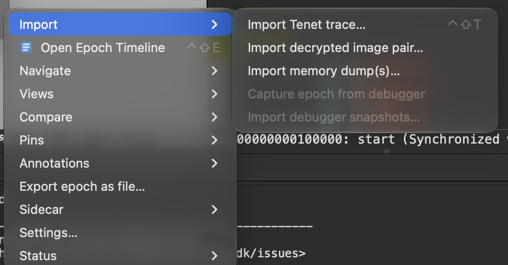

The result dialog reports four imported epochs (three execution waves) in this
fixture. This screenshot is from a **second** import, so it also says the existing
identical source was kept. On a first import, that last message is absent.

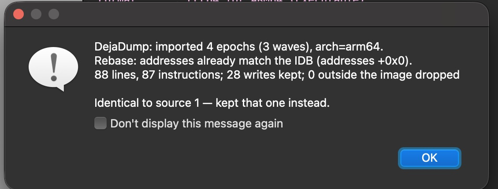

## 3. Epoch Timeline — `Ctrl-Shift-E`

1. **Switch epochs:**
   - Drag the slider from **t0** to **t3**, or press `Alt+]` / `Alt+[` (the toolbar
     arrows do the same).
   - At `0x200000` the disassembly changes on every wave: `MOV W9, #0xAA` →
     `#0xBB` → `#0xCC`.
   - With the decompiler, the pseudocode of that function changes as well.
2. **Status line:** shows the switch time, the time spent in analysis, and the
   number of changed bytes.
3. **Click the slider track:** the switch happens after a short pause, and the
   slider always shows the epoch the IDB really holds.
4. **History back / forward:** retraces your path, like browser history.
5. **Table:**
   - Star t3 (double-click ☆) and tick **Favorites only**.
   - Double-click the *label* cell of t1 and type `first stub`. Labels and notes
     are saved in the sidecar.
   - Type `wave` in the filter box.
6. **Go to epoch…** (Navigate menu) opens the epoch picker. Pick t2.

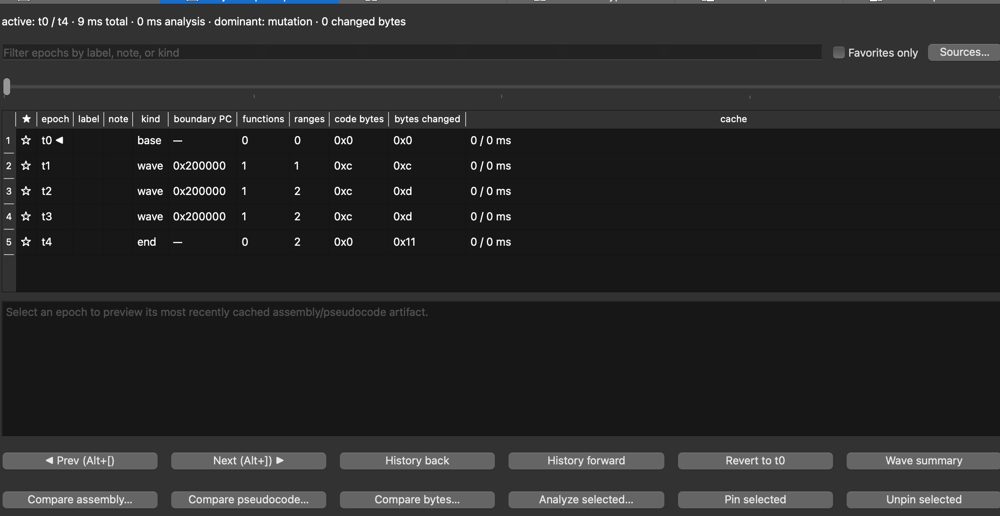

## 4. The listing shows time

At `0x200000` the anterior banner reads
`[DejaDump] volatile 0x200000–… · active t2 / t4 · versions: t1,t2,t3`. The
lines that t2 changed compared with t1 are highlighted. **Views → Toggle
changed-line highlighting** turns the highlight off and on. It never writes colours
into the IDB.

At the same address, t1 contains `MOV W9, #0xAA` and t2 contains
`MOV W9, #0xBB`. The banner names the active epoch and the versions available for
that volatile range; the warm background marks changed lines.

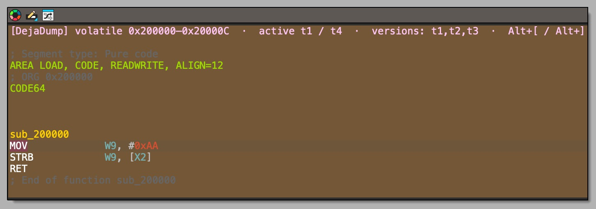

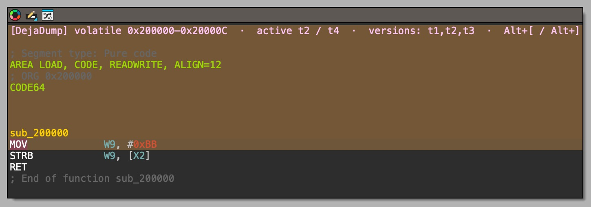

## 5. Wave summary

**Views → Wave summary… → t4.** The list shows:
- the captured range in `DATA`;
- a `string` row with **`DEJADUMP_OK!!!!`**, the string this wave revealed.

Double-click the string to jump there in t4. Now run the summary for **t2**. It
shows the `BUF` range and, once you have visited t1 and t2, the changed function
(`function ~`).

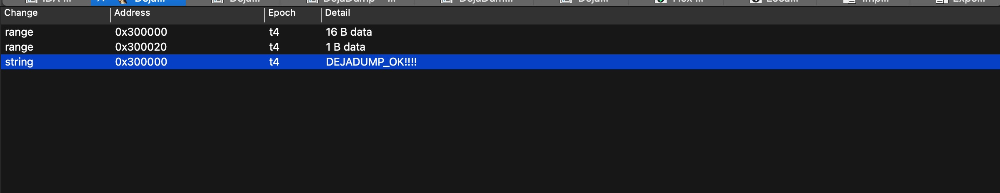

## 6. Per-epoch annotations

1. Activate **t1**, put the cursor on `0x200000` and rename it **`stub_v1`** (`N`).
2. Activate **t3**. The name is **gone**, because t3 has its own annotations.
3. Activate **t1** again. **`stub_v1`** is back.
4. **Annotations → Promote active annotations to all epochs…** makes the current
   names valid in every epoch.
5. **Copy annotations between epochs…** copies one epoch's annotations to another.

## 7. Memory Timeline — `Ctrl-Shift-M`

1. Go to `0x300000`, select 16 bytes, and press `Ctrl-Shift-M`.
2. The header reads *first plaintext at t4*.
   - Columns t0–t3 hold ciphertext. Cells that changed are tinted.
   - Column t4 reads `DEJADUMP_OK!!!!` once you set *Format* to **ASCII**.
   - The active epoch's column is marked ◀.
3. **Filters and formats:**
   - Tick **Changed rows only**.
   - Use **Compare two epochs…** with t3 and t4.
   - Try the u32 format.
   - Type an address and press **Go**.
4. **Double-click** a changed cell. DéjàDump activates that epoch and jumps to the
   decryption loop that wrote it.
5. **Export CSV…** writes the full grid; **Export Markdown…** writes the filtered
   rows.

In ASCII format, read down the t4 column to see the decrypted string. The header
marks t4 as the first plaintext epoch.

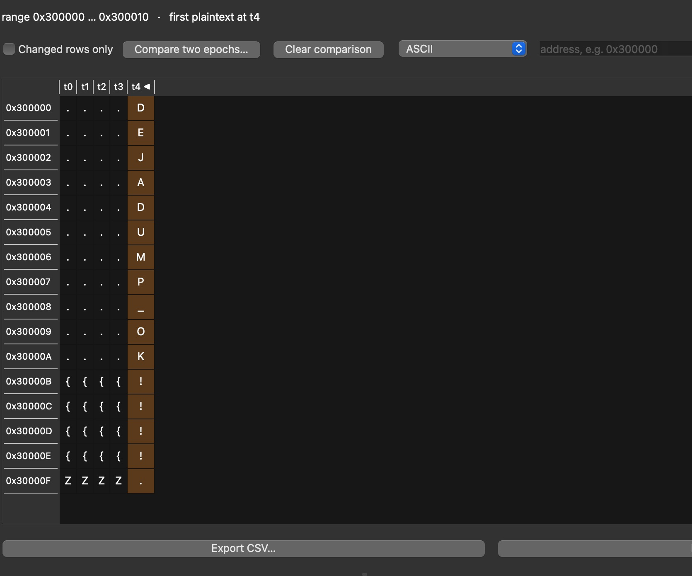

The t4 listing also shows the decrypted `DEJADUMP_OK!!!!` string at `0x300000`.
This is the ordinary IDA data view after activating t4, separate from the Memory
Timeline grid described above.

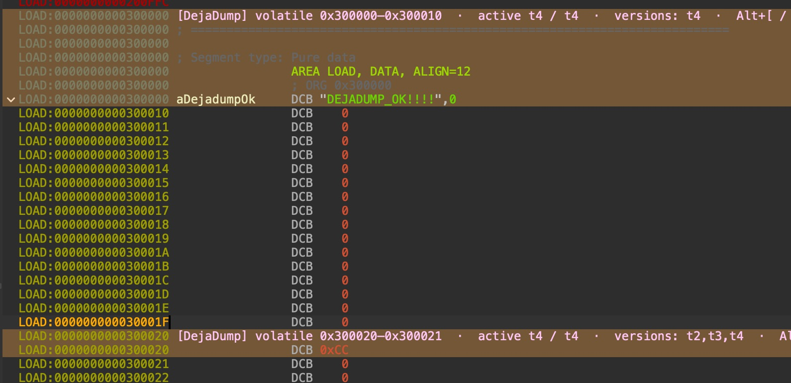

## 8. Who wrote this, and when — `Ctrl-Shift-W` / `Ctrl-Shift-X`

1. Open **Write History** (`Ctrl-Shift-W`). It follows the cursor: move around
   `0x300000` and the list updates without polling.
2. On `0x200000`, run **Temporal xrefs for this address** (`Ctrl-Shift-X`). It
   reports writes at **t1, t2, t3** by three different instructions.
3. Press **X** on `0x200000`. IDA's own xref list shows the three writers, each
   commented with the epoch and the value written.
4. **Annotations → Materialize write provenance** does this for every writer at
   once, with one summary comment per writer.
5. **Remove DejaDump write xrefs** removes exactly those xrefs and comments.

At `0x200000`, Write History lists the three epochs and the instruction address
that wrote each version. The dialog is the temporal-xref result for the same
address. Materialized provenance is visible as `[DejaDump]` comments beside the
writer instructions.

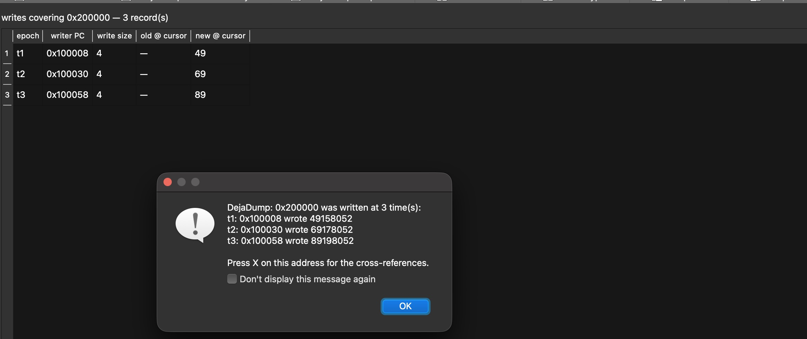

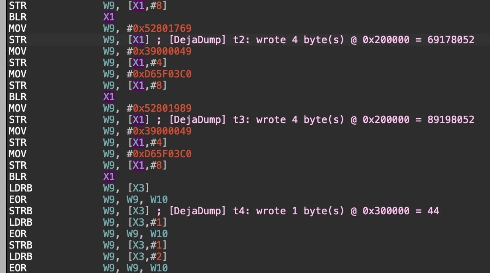

## 9. Compare versions

1. Put the cursor in the function at `0x200000` and press the toolbar **Compare**
   button (or **Compare → Compare assembly with epoch…**).
2. Pick t1 and choose **normalized**. The **Unified** tab is coloured. The **Side by
   side (aligned)** tab pads both sides so matching lines share a row.
3. Select a line and press **Jump to selected line in t1**.
4. In a pseudocode view, the same toolbar button compares pseudocode.
5. **Compare raw bytes with epoch…** diffs the bytes.

The assembly example compares active t3 against t1. The unified view marks the
changed immediate in red and green; the aligned view places both versions on the
same row. The pseudocode view below compares t3 against t2 and shows the changed
constant in Hex-Rays output.

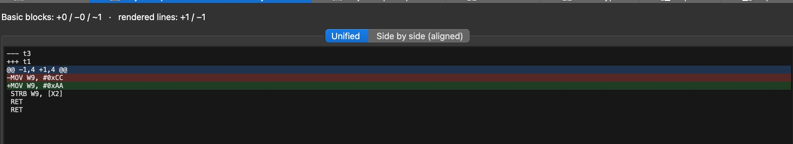

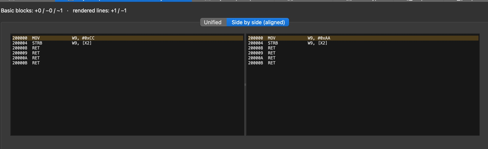

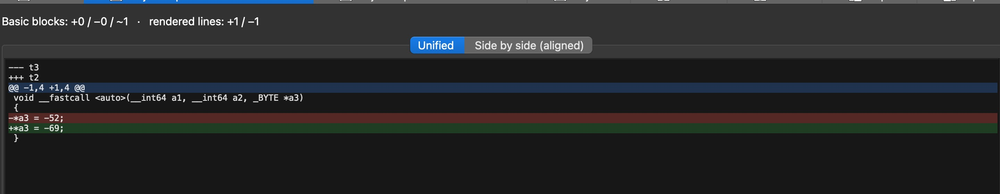

## 10. Cache and background workers

- **Compare → Pre-analyze assembly for all epochs** renders the function in every
  epoch and caches it.
  - With an idalib worker configured, this runs in parallel and never touches your
    IDB.
  - Without one, DéjàDump switches through the epochs and returns to the one you
    started on.
- Select an epoch in the Timeline to preview its cached rendering.
- **Clear analysis cache** empties the cache.

## 11. Pin an epoch side by side (Mode B)

1. **Pins → Pin epoch… → t1.** A shadow segment `.deja.t1.0` appears, with the
   t1 stub at `0x100100200000` named `t1_…`. You can now read it next to whatever
   epoch is active.
2. **Preview/rebase typed pointers in pin…** lists typed pointers that could be
   redirected into the shadow copy. Nothing changes until you confirm.
3. **Unpin epoch… → t1** removes the segment and keeps the annotations you made
   there.

The Pin menu opens the epoch chooser. The pinned t1 view has its own
`.deja.t1.0` segment and `t1_sub_200000` function at `0x100100200000`, while the
canonical `0x200000` address can show t3. The two screenshots show those locations
in the same database.

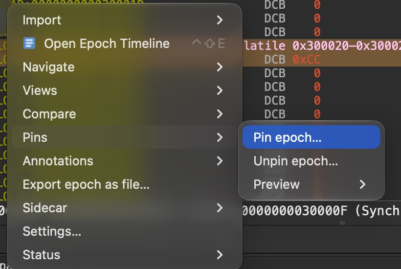

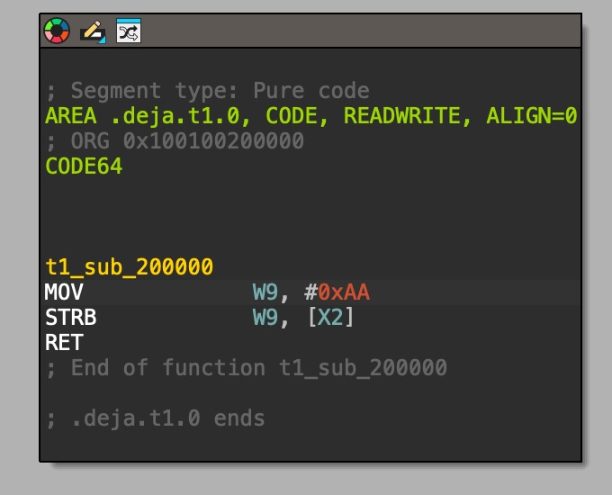

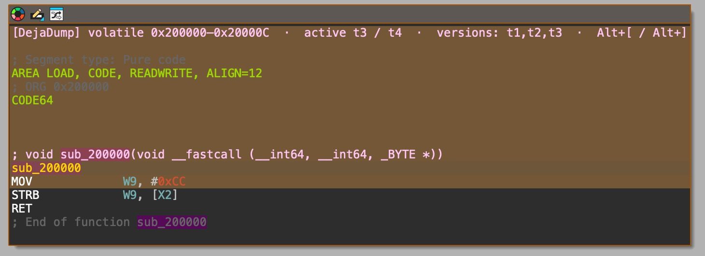

## 12. Search every epoch

**Views → Search all epochs… → `"DEJADUMP_OK"`.** One hit at `0x300000`,
present only in **t4**, with a byte preview. Press Enter: DéjàDump activates t4 and
jumps there. Hex patterns work too (`aa bb cc`).

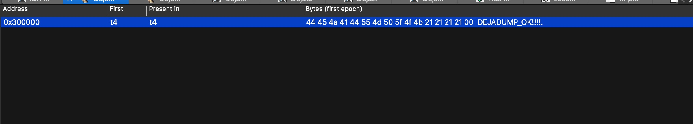

## 13. Export an epoch as a file

**Export epoch as file… → t4** writes `arm64_smc.t4.elf`. Open it in a second IDA
instance: `0x300000` already holds the plaintext. This is the shareable, decrypted
binary.

## 14. Image pairs and memory dumps (no trace needed)

Use a fresh copy of `arm64_smc.elf` for this part.

1. **Import → Import decrypted image pair… → `arm64_smc.t4.elf`** (from step 13).
   One `dump` epoch holds everything that differs. The dialog compares entropy and
   prologue counts for the largest region. The headless equivalent is
   `python tools/verify_image_pair.py tests/fixtures/arm64_smc.elf arm64_smc.t4.elf`.
2. **Memory dumps,** which is what GDB, LLDB, Frida or `/proc/<pid>/mem` produce:
   ```
   python tools/make_demo_dumps.py          # writes buf_t1/t2/t3.bin, base 0x200000
   ```
   **Import → Import memory dump(s)…**, then for each file in time order:
   - choose the file;
   - enter `0x200000` as its address;
   - answer *Add another dump?* with Yes.

   Three epochs appear, matching t1–t3 of the trace. The writer column shows `dump`.
   [USER_GUIDE §6.2](USER_GUIDE.md#62-memory-dumpers) has recipes for real tools.
3. The same flow works on a real runtime-decrypted library: open the on-disk module,
   dump its decrypted code with one of those tools, and import the dump.

## 15. Debugger snapshots

On a program you can debug (the corpus stubs are built for emulation and may not
run natively):
1. Suspend at a breakpoint after it unpacks, and run **Import → Capture epoch from
   debugger**. Repeat at later breakpoints.
2. Stop the debugger, then run **Import → Import debugger snapshots…**. One
   `snapshot` epoch is created per capture.

## 16. Sources

1. **Sidecar → Manage sources…** lists every import: the trace, the pair, the dumps
   and the snapshots.
   - **Enter** makes one active. The current source is reverted to t0 first.
   - **Ctrl-E** renames a source.
   - **Del** deletes one.
2. Import `arm64_smc.tenet` a second time. DéjàDump notices it is identical to
   the existing source and offers to keep the old one.

## 17. Sidecar and recovery

1. **Sidecar → Sidecar health / checkpoint** shows the integrity, the counts, any
   unsaved annotation edits, and file sizes.
2. **Compact sidecar** reclaims the space of deleted sources.
3. Close IDA, move `arm64_smc.dejadump.db` elsewhere, reopen the IDB, and run
   **Locate sidecar…**. Close and reopen the IDB once more: the sidecar is found
   again on its own.
4. **Undo** (`Ctrl-Z`) right after a switch rolls the bytes back. The next switch
   notices and re-identifies the epoch. **Navigate → Revert to t0** is always the
   deterministic way back.
5. **Status / about** summarises the sidecar, the active source and epoch, the
   worker, and any reason switching is disabled.

## 18. Headless import for big traces

```
python -m dejadump import tests/fixtures/arm64_smc.tenet \
    --sidecar /tmp/demo/arm64_smc.dejadump.db --elf tests/fixtures/arm64_smc.elf
python -m dejadump info --sidecar /tmp/demo/arm64_smc.dejadump.db
```
Copy `arm64_smc.elf` to `/tmp/demo/`, open it, and the epochs are already there.
`export`, `dumps` and `compact` work the same way.

## 19. Same idea, other ISA (x86-64)

Repeat steps 1–13 with **`tests/fixtures/x64_smc.elf`** and `x64_smc.tenet`. You get
the same four epochs, three `mov byte [rsi],0xAA/0xBB/0xCC` versions at `0x200000`,
and the same plaintext at t4. `python tools/make_demo_dumps.py --x64` writes the
matching dumps.

## 20. Verification (idalib, licensed)

idalib needs no `pip install`: point any supported Python at an IDA installation.
On macOS:
```
IDA="/Applications/IDA Professional 9.5.app/Contents/MacOS"
export IDADIR="$IDA" PYTHONPATH="$IDA/idalib/python"
```
On Linux and Windows, `IDADIR` is the IDA directory and `idalib/python` sits
inside it. Then:
```
python tools/smoke_mode_a.py            # arm64: expect "SMOKE: PASS"
python tools/smoke_mode_a.py --x64      # x86-64
DEJADUMP_FAULT_TESTS=1 python tools/smoke_mode_a.py   # rollback at every journal stage
python tools/smoke_real_pair.py <encrypted.so> <encrypted.so.dejadump.db>   # your own library, out of tree
```
The smoke test checks:
- the code differs per epoch;
- names round-trip and do not leak between epochs;
- changed spans are reported;
- provenance xrefs are created;
- the data-only fast path skips analysis;
- pin cleanup works;
- a second source gets its own t0 snapshot.

It runs on a temporary copy, so repeated runs start clean.
