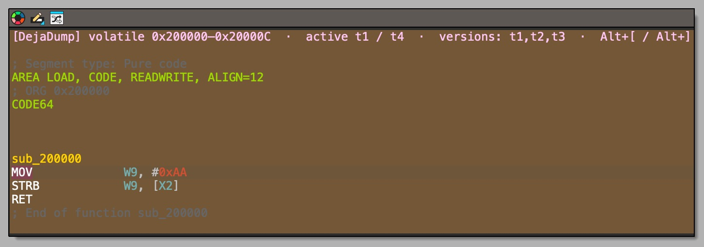
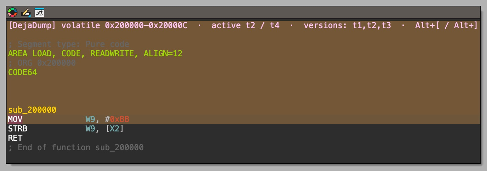
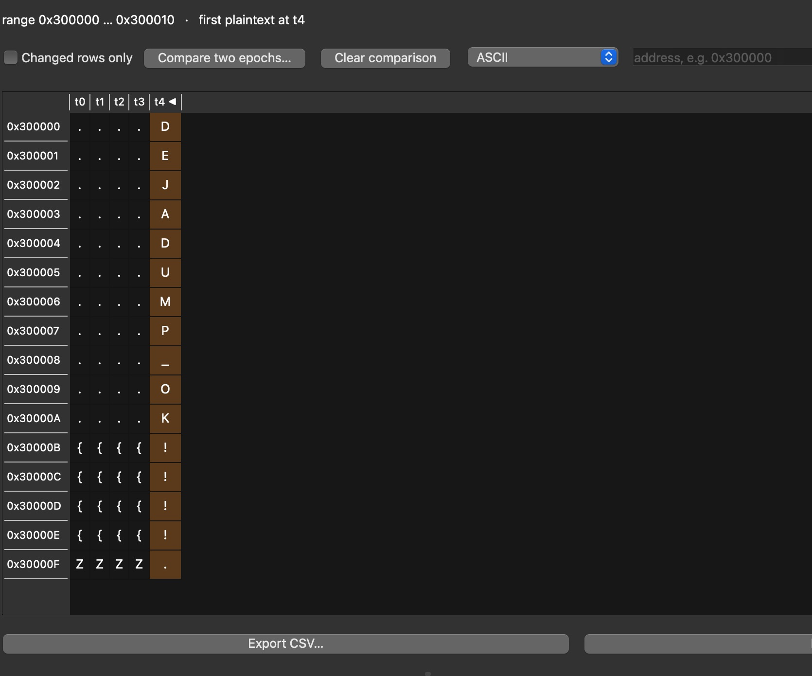

# DejaDump — Design

## The problem
IDA's address space is single-valued: one byte, one item, one function per address.
Packers, staged loaders and self-modifying code (SMC) overwrite the same region
several times, and data that drives control flow (keys, tables, flags) changes as
execution proceeds. Today an analyst juggles several IDBs and overwriting memory
snapshots; cross-references and pseudocode only ever exist for whichever version
happens to be loaded.

## The model: epochs (waves)
DéjàDump adds **epochs** as a first-class dimension of one IDB.

- An **epoch** (wave) is a contiguous interval of execution during which no
  instruction executes from memory written earlier in the same interval. A new
  epoch begins when an executed instruction's bytes intersect memory written since
  the last boundary — **byte-granular**, after CoDisasm's wave semantics (a 4–16 KiB
  page set is kept only as a fast pre-filter, so code and data sharing a page do not
  cause false boundaries).
- **State(k, range)** is read-through: for every byte, the snapshot from the most
  recent epoch ≤ k that dirtied it, else the base (epoch-0) image — Ghidra's
  trace-memory model.
- Identical consecutive commits are suppressed (content-addressed dedupe), so a
  rewrite loop does not explode the timeline.

## Architecture
```
Capture adapters  →  WaveDetector  →  EpochStore (SQLite sidecar + netnode index)
                                         │
                 StateResolver  ─────────┤
                                         ├─ Mode A (swap-in-place time slider)
                 MemoryTimeline ─────────┤
                                         └─ Write History / temporal xrefs
```
- **Engine** (`dejadump/core/`, pure Python, unit-tested headless): `model`,
  `intervals`, `waves` (byte-granular detection), `store` (content-addressed
  SQLite), `tenet` (streaming importer: filtering, rebasing, observed reads),
  `state` (read-through + diff planning + changed spans), `timeline`, `search`,
  `diffing`, `annotation_model` (annotation deltas); `capture/rawdump` (image
  pairs, memory dumps, export); `cli` (headless import/export/maintenance).
- **IDA layer** (only imported inside IDA): `modes/mode_a` (activation),
  `modes/tracking` (annotation dirty-tracking hooks), `modes/mode_b` (pins),
  `core/annotations` (capture/clear/restore), `hexrays/bridge` (decompiler
  invalidation + temporal xrefs), `render` (renderers shared with the idalib
  `worker`), `ghost` (worker pool), `ui/` (PySide6 panels and native choosers),
  `controller` (one per open database).

## Mode A — the time slider
`activate(k)` turns the loaded bytes into epoch *k* and re-runs IDA's own analysis
over only what changed:

> guard (no debugger / auto / user patches) → snapshot t0 for any uncovered
> volatile range → verify the loaded bytes are the recorded epoch → persist the
> current epoch's edited annotation pages → diff current↔target over the volatile
> set (journaled with preimage hashes) → `del_items` + `put_bytes` → set the ARM
> `T` sreg → `auto_mark_range(AU_CODE)` over *code* ranges + `auto_wait_range` →
> annotation delta (remove what only the outgoing epoch had, apply what differs) →
> verify → `mark_cfunc_dirty` → decorate volatile regions → refresh.

`put_bytes` is used (not `patch_bytes`) so epoch bytes never create patch records.
`Revert to t0` / re-`activate` is the deterministic inverse (IDA undo is best-effort;
the pre-switch verification notices when undo changed the bytes). Changed lines are
highlighted through the line-rendering UI hook, never by writing IDB colours.

The two captures show the same canonical address at t1 and t2. IDA displays a
different instruction while the volatile-range banner records which epoch is
active.





## Data over time
The **Memory Timeline** shows one column per epoch and one row per byte, with
changed cells highlighted and a "first-plaintext" marker where a region becomes
text-like. The **Write History** and **temporal xrefs** attribute each write to the
instruction that performed it (respecting the Tenet writer-PC lag), so a single
location can be cross-referenced across every epoch it was written.



## Prior art and what is new
Loading all the waves of an unpacker into one IDB is **published prior art** and is
cited, not claimed:

- Bonfante, Fernandez, Marion, Rouxel, Sabatier & Thierry, *CoDisasm* (CCS 2015,
  DOI 10.1145/2810103.2813627) — formal wave semantics for SMC.
- Ul Haq, Chica, Caballero & Jha, *Malware Lineage in the Wild* (arXiv:1710.05202)
  — loads every wave into one IDB, hash-deduped, overlapping ranges relocated.
- Korczynski, *RePEconstruct* (MALWARE 2016) — dynamic unpack into numbered waves,
  emits one-shot IDAPython; no navigable per-epoch analysis.
- Ghidra's debugger trace DB — read-through memory and snapshot-scoped markup that
  vanishes when you step back.

**The unprecedented, demonstrable delta:** making each version *live* — interactive
per-epoch Hex-Rays pseudocode, swap-in-place at the canonical address with scoped
re-analysis and decompiler-cache invalidation, a time-slider / memory-timeline /
temporal-xref workflow — shipped as a maintained, installable IDA plugin.

See `FORMATS.md` for the data formats, `USER_GUIDE.md` for every feature, and
`DEMO.md` to reproduce.
