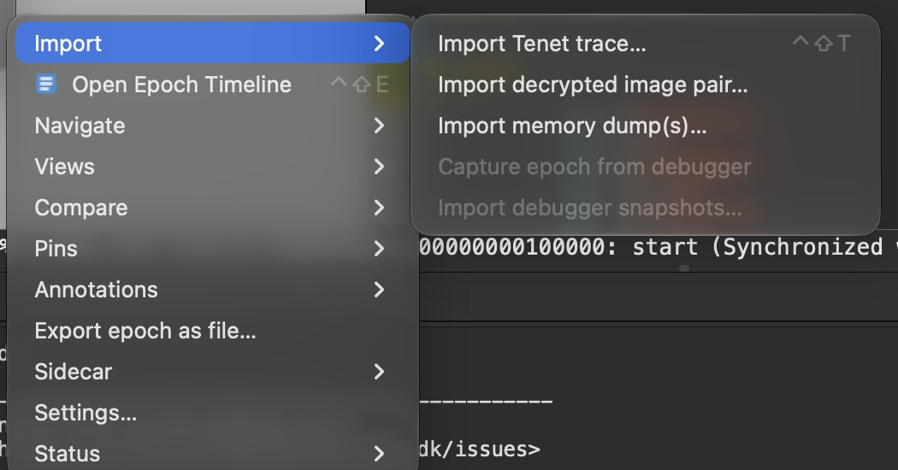
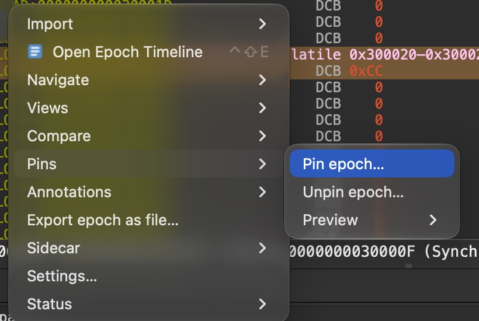
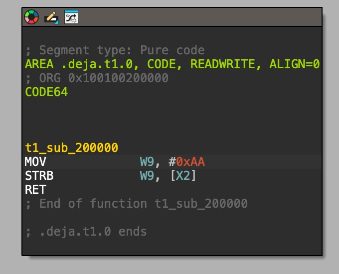
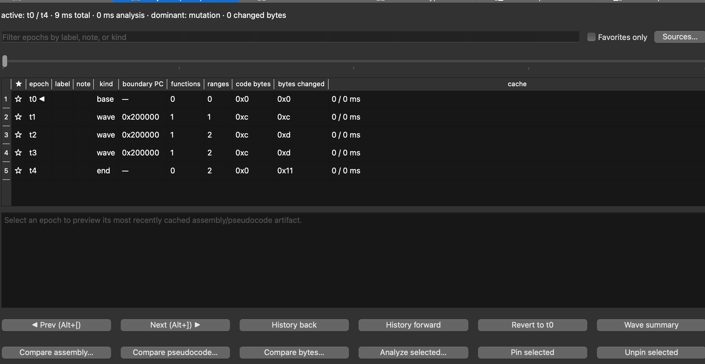
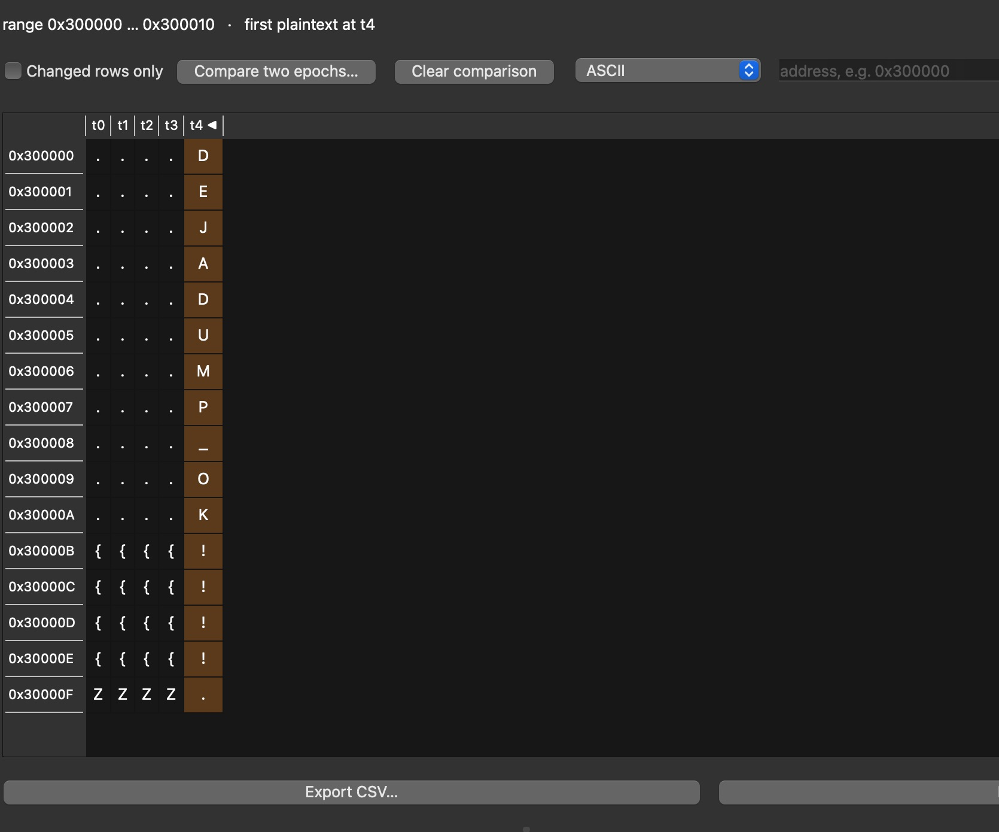
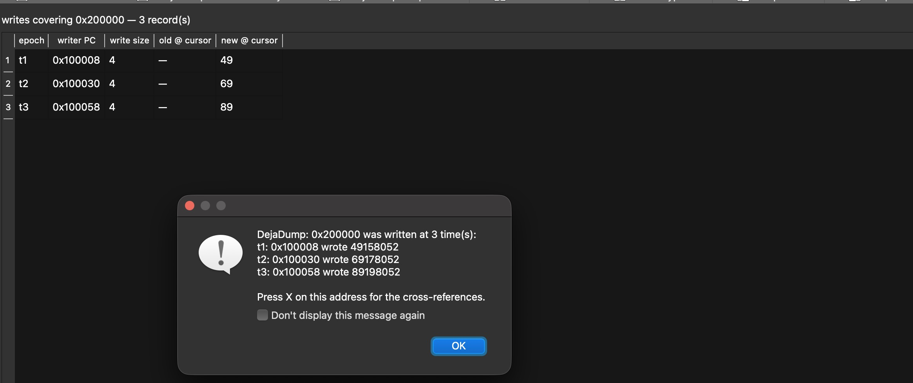
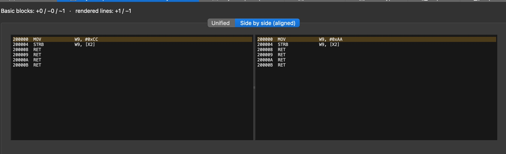
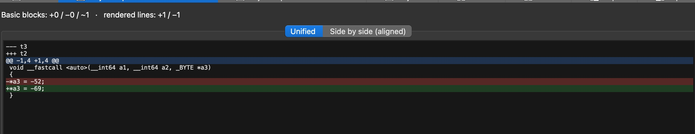
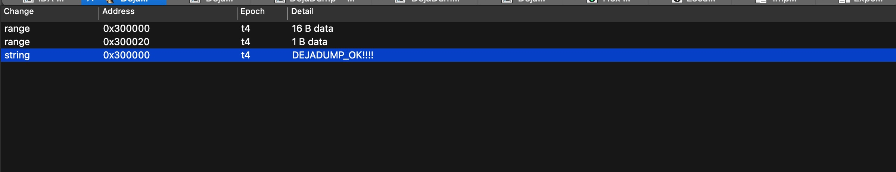
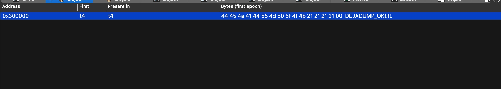

# DejaDump — User Guide

This guide covers every feature, menu item, hotkey, toolbar button, panel and
setting. To see the features in action, follow the step-by-step walkthrough in
[DEMO.md](DEMO.md). File and database formats are in [FORMATS.md](FORMATS.md).
The design and prior art are in [DESIGN.md](DESIGN.md).

- [1. Concepts](#1-concepts)
- [2. Installation and requirements](#2-installation-and-requirements)
- [3. Where things are](#3-where-things-are)
- [4. Menu reference](#4-menu-reference)
- [5. Panels and windows](#5-panels-and-windows)
- [6. Getting traces and dumps](#6-getting-traces-and-dumps)
- [7. How imports are interpreted](#7-how-imports-are-interpreted)
- [8. Safety model](#8-safety-model)
- [9. Settings and environment variables](#9-settings-and-environment-variables)
- [10. Headless command line](#10-headless-command-line)
- [11. Performance and limits](#11-performance-and-limits)
- [12. Troubleshooting](#12-troubleshooting)

---

## 1. Concepts

**Epoch (wave).** One version of a self-modifying or unpacking program's memory.
Epoch **t0** is the image IDA loaded from disk. Epochs **t1, t2, …** are the later
versions the program created at run time.

**Wave boundary.** In a trace, a new epoch starts when the program *executes* bytes
it wrote since the last boundary. The test is byte-granular, so code and data that
share a page do not split epochs by accident. Other boundary kinds:
- `dump`: a memory or file image import.
- `snapshot`: a debugger snapshot.
- `manual`: IDB changes you captured.
- `end`: writes left over after the last boundary.

**Source.** One import: a trace, an image pair, a set of memory dumps, or debugger
snapshots. Each source has its own epochs. One source is *active* at a time. Every
source shares the same t0, the loaded image.

**Volatile set.** The union of all address ranges any epoch of the active source
changed. Only these bytes are ever swapped. Everything else in the IDB is stable and
shared by all epochs.

**Read-through state.** The bytes of epoch *k* are the t0 snapshot, overlaid by
epochs 1…*k* in order. DéjàDump computes this for any epoch without changing the
IDB. Searches, comparisons, the Memory Timeline and exports all read state this way.

**Active epoch (Mode A).** The epoch whose bytes are currently in the IDB at their
real (canonical) addresses. A switch does the following:
1. Rewrites only the bytes that differ.
2. Re-runs IDA's analysis over the changed code.
3. Swaps the per-epoch annotations.
4. Invalidates the decompiler cache.

Everything IDA shows (listing, xrefs, functions, Hex-Rays) is therefore native for
the active epoch.

**Pin (Mode B).** A copy of one epoch placed in separate *shadow segments* at a high
address. It lets that version sit beside the active one for side-by-side navigation.

**Per-epoch annotations.** Some annotations belong to the epoch you made them in.
These are:
- names and comments
- extra (anterior/posterior) lines
- types and colours
- operand formats, forced operands and manual instructions
- function flags, comments, frames and tails
- Hex-Rays local-variable settings

Rename a function at t1 and the name appears only at t1. *Promoted* annotations
are shared by every epoch of the source. Annotations outside the volatile set are
ordinary IDB annotations and never change.

**Sidecar.** An SQLite file next to the IDB, `<idb>.dejadump.db`, that stores
sources, epochs and deduplicated bytes, write provenance, annotations and caches.
A small index inside the IDB (the `$ dejadump` netnode) ties the IDB to its
sidecar. Losing the sidecar never corrupts the IDB; it only loses history.

**Observed reads.** Bytes a trace *read* but never wrote, such as loader
relocations or buffers filled by the kernel. They appear in the data views from t1
on. They are never written into the IDB.

---

## 2. Installation and requirements

| Requirement | Notes |
|---|---|
| IDA Pro 9.4 / 9.5 or IDA Home 9.4+ | IDA Free is not supported. The GUI uses PySide6. |
| Python 3.10+ (IDAPython 3) | The engine uses only the standard library. |
| Hex-Rays decompiler (optional) | Needed for pseudocode comparison and per-epoch pseudocode. |
| idalib (optional) | Ships with IDA Pro and IDA Home 9.4+. Lets comparisons render in background workers. |

**Install from the plugin repository** (after publication):
```
hcli plugin install dejadump
```

**Install from a checkout (development).** Link `dejadump_plugin.py` into IDA's
user plugin directory: `~/.idapro/plugins` on Linux and macOS, or
`%APPDATA%\Hex-Rays\IDA Pro\plugins` on Windows. Some macOS installations use
`~/Library/Application Support/IDA Pro/plugins` instead. The entry point follows the
symlink back to the checkout, so the adjacent `dejadump/` package is found.
Restart IDA. A successful load prints `DejaDump <version> loaded` in the Output
window.

**Background workers (optional).** Open **Edit → DejaDump → Settings…** and pick a
Python interpreter that can `import idapro`. Use **Test interpreter** to check it.
Without a worker, comparisons switch the IDB to the other epoch, render it, and
switch back.

---

## 3. Where things are

- **Menu:** **Edit → DejaDump** contains every action, grouped into submenus:
  Import, Navigate, Views, Compare, Pins, Annotations and Sidecar. Some actions sit
  at the top level. See [section 4](#4-menu-reference).
- **Toolbar:** a movable **DejaDump** toolbar with five buttons: Open Epoch
  Timeline, Previous epoch, Next epoch, Compare with epoch…, and Temporal xrefs for
  this address. If you can't see it, right-click IDA's toolbar area and enable
  *DejaDump*.
- **Context menus:**
  - Right-click in a disassembly view for **DejaDump/** → Compare assembly, Compare
    raw bytes, Memory Timeline, Write History, Temporal xrefs and Search all epochs.
  - Right-click in a pseudocode view for Compare pseudocode and Compare assembly.
- **Listing decorations:**
  - Each volatile range starts with a banner line:
    `[DejaDump] volatile 0x…–0x… · active tK / tN · versions: t1,t2,…`.
  - Lines whose bytes the active epoch changed are highlighted (see *Toggle
    changed-line highlighting*). Your own anterior lines stay above the banner.
- **Enabled state:**
  - Every action except **Status / about** needs an open database.
  - Actions that work on epochs stay disabled until something has been imported.
  - **Capture epoch from debugger** needs a suspended debuggee.
  - **Import debugger snapshots…** needs captured snapshots and a stopped debugger.



---

## 4. Menu reference

Each entry lists the menu path under **Edit → DejaDump**, the hotkey if any, and
what the action changes.

### Import

#### Import Tenet trace… — `Ctrl-Shift-T`
- **What it does:**
  - Reads a Tenet or Frinet text trace, splits it into epochs at wave boundaries,
    and stores it as a new source.
  - Only writes inside the IDB's segments are kept (see *Settings*).
  - The trace is rebased onto the IDB automatically; see [7.1](#71-traces).
  - Shows a progress box you can cancel. A cancelled import stores nothing.
  - The result dialog reports the epochs and waves found, the rebase used, the
    writes kept and dropped, the observed reads, and any malformed lines.
  - If the import is byte-identical to an existing source, you can keep the old
    source instead.
- **Before importing:** if another source is active and not at t0, DéjàDump
  reverts it to t0 first.
- **Changes:** adds a source to the sidecar. The IDB is not modified, apart from the
  t0 snapshot of new ranges.

#### Import decrypted image pair…
- **What it does:**
  - Imports a *file-layout* image of the current module as epoch t1, for example
    the output of a static unpacker or decryptor.
  - The IDB's original input file is t0. If it has moved, you are asked for it.
  - ELF32 and ELF64 are mapped through their program headers. Other formats are
    treated as a flat image at the IDB image base.
  - The dialog compares entropy and prologue counts for the largest changed region.
- **Changes:** adds a source.

#### Import memory dump(s)…
- **What it does:**
  - Imports one or more *memory-layout* dumps, i.e. raw bytes starting at a known
    address, as successive epochs.
  - For each dump, enter the **IDB address** of its first byte (see
    [6.2](#62-memory-dumpers)).
  - Dump 1 is diffed against the bytes loaded in the IDB, dump 2 against dump 1, and
    so on.
  - Only bytes inside the IDB's segments are used.
  - The segment's execute permission decides whether each change is treated as code
    or data.
- **Changes:** adds a source.

#### Capture epoch from debugger
- **What it does:**
  - While the process is suspended in IDA's debugger, reads the program's segments
    from process memory into a *pending snapshot*.
  - Debugger-created segments are skipped.
  - If IDA rebased the program to its load address, the snapshot is converted back
    to IDB addresses.
  - Capture as many snapshots as you like, at different breakpoints.
- **Changes:** nothing until you import the snapshots. Snapshots are held in memory
  until then.

#### Import debugger snapshots…
- **What it does:** after the debugger stops, turns the pending snapshots into
  epochs, in capture order, of a new `debugger` source.
- **Changes:** adds a source and clears the pending list.

### Top level

#### Open Epoch Timeline — `Ctrl-Shift-E`
Opens the Epoch Timeline panel (see [5.1](#51-epoch-timeline)). Also the first
toolbar button.

#### Export epoch as file…
- **What it does:** writes the chosen epoch's bytes back into a copy of the input
  file. The default name is `<name>.t<k><ext>`.
  - For ELF, volatile ranges are mapped back to file offsets, and bytes without file
    backing (e.g. `.bss`) are skipped.
  - Other formats are written as a flat image at the image base.
- **Use it to:** hand a decrypted or unpacked binary to other tools, or open it as a
  new IDB.
- **Changes:** writes the new file only.

#### Settings…
Opens the settings dialog (see [section 9](#9-settings-and-environment-variables)).

#### Status / about
Shows the following:
- Version, IDA version and Hex-Rays availability
- The configured worker
- Sidecar path, active source and active epoch
- Why switching is disabled, if it is
- Pending debugger snapshots
- A pointer to this guide

### Navigate

#### Next epoch — `Alt-]`  ·  Previous epoch — `Alt-[`
Activate the epoch after or before the active one. Both are also on the toolbar.

#### Go to epoch…
Pick any epoch from the epoch picker and activate it.

#### Epoch history back  ·  Epoch history forward
Move through the epochs you activated in this session, like browser history.

#### Revert to t0
- **What it does:** returns the volatile set to the loaded image. Before switching it
  saves the current epoch's annotations; afterwards it restores t0's.
- **When to use it:** this is the deterministic way back, and it also works when the
  IDB holds a *mixed* state, i.e. bytes that match no epoch.
- **Changes:** IDB bytes, analysis and annotations in the volatile set.

### Views

#### Wave summary…
Opens the wave summary for the epoch you choose (see [5.5](#55-wave-summary)).

#### Memory Timeline (selection) — `Ctrl-Shift-M`
Opens the Memory Timeline for the selection, or for the item under the cursor. The
range is limited to 4 KiB (see [5.2](#52-memory-timeline)).

#### Write History (cursor) — `Ctrl-Shift-W`
Opens the Write History panel, which follows the cursor (see
[5.3](#53-write-history)).

#### Temporal xrefs for this address — `Ctrl-Shift-X`
- **What it does:**
  - Lists every epoch in which the address under the cursor was written, and by
    which instruction.
  - Opens Write History.
  - For writers in stable code, adds a `dr_W` cross-reference from the writer to the
    address, and one summary comment per writer. Press **X** on the address to see
    the result in IDA's own xref list.
- **Changes:** adds xrefs and comments that DéjàDump owns and can remove.

#### Search all epochs…
- **What it does:** searches the bytes of every epoch for a hex pattern (`de ad be
  ef`), a quoted string (`"text"`) or plain text, without switching epochs. Results
  open in a list (see [5.6](#56-search-results)).
- **Typical use:** find a string that exists only after decryption.

#### Toggle changed-line highlighting
- **What it does:** turns on or off the background highlight on listing lines whose
  bytes the active epoch changed relative to the previous epoch.
- **How it works:** drawn through IDA's line-rendering hook, so it never writes
  colours into the IDB and your own item colours stay visible. The setting is
  remembered.

### Compare

#### Compare with epoch… (toolbar)
Compares the current function with another epoch. It uses pseudocode in a
decompiler view and assembly elsewhere.

#### Compare assembly with epoch…  ·  Compare pseudocode with epoch…  ·  Compare raw bytes with epoch…
- **What gets compared:**
  - The selection, or else the function under the cursor.
  - Raw bytes compare 256 bytes from the cursor when nothing is selected.
- **Options:** choose the other epoch, then exact or *normalized* output. Normalized
  output ignores addresses, automatic labels (`sub_…`, `loc_…`) and whitespace.
- **Fallback:** if either side cannot be decompiled, the comparison falls back to
  assembly and says so in the title.
- **Result:** opens a diff viewer (see [5.4](#54-diff-viewer)).
- **Caching:** renderings are cached in the sidecar per epoch and per analysis
  version, so repeated comparisons are instant.

#### Pre-analyze assembly for all epochs  ·  Pre-analyze pseudocode for all epochs
- **What it does:** renders the current function in every epoch and caches the
  results.
- **How:** with a configured idalib worker, this runs in up to four background
  workers. Without one, each epoch is switched in turn and the original epoch is
  restored at the end.
- Shows a progress box you can cancel.

#### Analyze current epoch (assembly)  ·  Analyze current epoch (pseudocode)
Renders and caches the current function for the active epoch only.

#### Clear analysis cache
Deletes all cached renderings.

### Pins

#### Pin epoch…
- **What it does:** copies an epoch (t1 or later) into sparse shadow segments named
  `.deja.t<k>.<n>`, starting at `0x100000000000 + k·0x100000000`.
- **Analysis and names:** code is analysed there, and entry points are named
  `t<k>_<original name>`.
- **Xrefs:** references from the shadow copy back to stable code get explicit user
  xrefs. PC-relative code works as is. No bytes are rewritten.
- **Supported targets:** AArch64 and x86-64 databases.
- **Changes:** adds segments that DéjàDump owns.





#### Unpin epoch…
Saves the annotations you made in the shadow copy into that epoch's annotations,
then deletes the shadow segments.

#### Preview/rebase typed pointers in pin…
- **What it does:** lists 64-bit pointers *that you have typed as pointers* in the
  canonical range and that point into shadowed ranges. It shows each old and new
  value, and applies the rebase to the shadow copy only after you confirm.
- **What it never does:** rewrite untyped data.

### Annotations

#### Materialize write provenance
- **What it does:** for every instruction in stable code that wrote into the volatile
  set:
  - adds `dr_W` xrefs to the start of each written span, up to 64 per writer and
    epoch;
  - adds one comment line per epoch, e.g.
    `[DejaDump] t2: wrote 4.1 MiB in 18312 stores @ 0x…–0x… (3 spans)`;
  - adds the same note to the pseudocode, with one decompilation per function.
- Existing xrefs are never claimed as DéjàDump's own.
- Shows a progress box you can cancel.

#### Remove DejaDump write xrefs
Removes exactly what provenance added: the owned xrefs, the `[DejaDump]` comment
lines, and the pseudocode notes. Your own text in the same comments is kept.

#### Promote active annotations to all epochs…
- **What it does:** copies the active epoch's annotations in the volatile set to
  every epoch of the source, and stores them as the source's shared overlay.
- **Use it for:** names that are valid in every version, such as the decryptor
  itself.

#### Copy annotations between epochs…
Copies one epoch's annotations onto another. Visit the source epoch at least once
first, so its annotations have been captured.

### Sidecar

#### Manage sources…
Opens the Sources window (see [5.7](#57-sources-window)). Use it to select, rename
and delete sources, and to spot duplicate imports.

#### Locate sidecar…
- **What it does:** opens a sidecar stored somewhere other than next to the IDB.
- **Remembered:** the IDB keeps its path, relative to the IDB when possible, so it
  is reopened automatically next time.

#### Sidecar health / checkpoint
- **What it does:** runs an integrity check and checkpoints the write-ahead log.
- **Reports:** the schema version, counts, any pending (interrupted) switch,
  annotation edits not yet saved to the sidecar, and file sizes.

#### Compact sidecar
- **What it does:** removes data nothing references any more (bytes of deleted
  sources, superseded caches), then rebuilds the file (`VACUUM`).
- Shows the size before and after.

---

## 5. Panels and windows

### 5.1 Epoch Timeline

The ARM64 demo trace produces t0 through t4. Its three `wave` rows are the
rewritten code versions; the `end` row contains the remaining data writes.



| Control | What it does |
|---|---|
| Status line | Active epoch / last epoch, plus timings of the last switch: total, analysis, the dominant phase, changed bytes, and whether a cached plan was used. |
| Filter box | Shows only epochs whose label, note or kind matches the text. |
| Favorites only | Shows only starred epochs. |
| Sources… | Opens the Sources window. |
| Slider | Drag and release to switch. Keyboard arrows and clicks on the track switch after a short pause. The slider always snaps back to the epoch the IDB really holds. |
| Table | One row per epoch. Double-click a row to activate it. Double-click ★/☆ to toggle a favourite. Double-click *label* or *note* to edit them; they are saved in the sidecar. |
| Preview | The most recent cached rendering of the selected epoch. |
| ◀ Prev / Next ▶, History back / forward, Revert to t0 | Same as the Navigate actions. |
| Wave summary | Summary of the selected epoch, or of the active one. |
| Compare assembly / pseudocode / bytes… | Same as the Compare actions. |
| Analyze selected… | Caches assembly or pseudocode for the selected epoch. |
| Pin selected / Unpin selected | Same as the Pins actions, for the selected row. |

Table columns:
- ★
- epoch (◀ marks the active one)
- label, note
- kind (`base`, `wave`, `dump`, `snapshot`, `manual`, `end`)
- boundary PC (the instruction that entered the new bytes)
- functions (entry points seen)
- ranges, code bytes, bytes changed
- cache (cached renderings and their total time)

### 5.2 Memory Timeline

One row per address, or per word in the typed formats, and one column per epoch.
The active epoch's column header carries ◀.



| Element | Meaning |
|---|---|
| Header | The range and the *first plaintext* epoch: the first epoch where the range becomes mostly printable text. |
| Warm cell background | The value changed from the previous epoch. |
| Green cell background | The epoch is at or after the first plaintext epoch. |
| Italic value | It comes only from an observed read (seen at run time, never written in the trace). |
| Tooltip | The writer(s) of that cell in that epoch, `dump` for imported images, or the observed-read note. |
| Double-click | Activates the cell's epoch and jumps to its writer. |
| Changed rows only | Shows only rows that change in some epoch. |
| Compare two epochs… / Clear comparison | Shows only rows that differ between two chosen epochs. |
| Format | Byte (hex), unsigned 16/32/64-bit little-endian, or ASCII. |
| Address + Go | Scrolls to an address inside the range. |
| Export CSV… | The whole range, every epoch. |
| Export Markdown… | The currently filtered rows. |

### 5.3 Write History

Lists every recorded write covering the cursor address. Columns: epoch, writer PC
(`dump` for image imports), write size, and the old and new byte at the cursor.
- **Follow cursor** (on by default) updates the list as you move.
- Untick it to keep one address.
- **Refresh** re-reads the cursor address.
- Double-click a row to activate that epoch and jump to the writer.



### 5.4 Diff viewer

The same diff can be viewed as unified changes or aligned side-by-side code.
Pseudocode comparison is available when Hex-Rays is installed.





The title says exact or normalized, the representation, and the two epochs. A
summary line counts basic blocks added, removed and changed, and rendered lines
added and removed.

- **Unified tab:**
  - Added lines are green, removed lines red, and hunk headers blue.
- **Side by side (aligned) tab:**
  - Both renderings are padded so matching lines share a row.
  - Insertions and deletions show as blank rows on the other side.
  - Replaced lines are amber.
  - The panes scroll together.
  - **Jump to selected line in tN** activates that epoch and goes to the line's
    address. Pseudocode lines map to the first ctree item on the line.

### 5.5 Wave summary

What epoch *k* changed compared with *k−1*. Double-click a row to activate the
right epoch and jump to it.



| Row kind | Meaning |
|---|---|
| `range` | A captured range: size, and whether it lies in a code or data segment. |
| `function +` / `function −` / `function ~` | A function present only in *k*, present only in *k−1*, or present in both with changed bytes. |
| `string` | A printable string (5+ characters) present at *k* that was not there at *k−1*. |
| `note` | Function lists need each epoch to have been activated once (or to be the active one). The note says which to visit. |

### 5.6 Search results



Columns:
- address
- the first epoch containing the match
- every epoch containing it
- the first 16 bytes there (hex and ASCII)

Press Enter or double-click to jump. If the active epoch contains the match,
DéjàDump jumps without switching; otherwise it activates the first epoch that
does.

### 5.7 Sources window

Columns: ID, label, kind, epochs, created, status (`active`, `duplicate of N`).

| Key | Action |
|---|---|
| Enter / double-click | Make the source active. The current source is reverted to t0 first. |
| Edit (Ctrl-E) | Rename the source. |
| Delete | Delete the source with its epochs, annotations, caches and pins. Run *Compact sidecar* afterwards to reclaim space. |

### 5.8 Epoch picker

A list of epochs you choose from in many actions. It shows:
- seq (◀ marks the active one)
- label (t0 is "loaded image")
- kind, ranges, bytes changed
- boundary PC

Ctrl-F filters the list, as in any IDA chooser. Enter selects.

---

## 6. Getting traces and dumps

DéjàDump does not ship capture tools. It reads the output of established ones.
Always capture only binaries you are allowed to analyse.

### 6.1 Tracers (→ *Import Tenet trace…*)

Any tracer that writes the [Tenet text format](FORMATS.md#1-tenet--frinet-trace-the-subset-dejadump-reads)
works. These are known to produce it:

| Tool | Platforms | Notes |
|---|---|---|
| [Tenet reference tracers](https://github.com/gaasedelen/tenet/tree/master/tracers) | Intel **Pin** (x86/x86-64, Windows and Linux) and a **QEMU** plug-in | The original tracers from the [Tenet project](https://blog.ret2.io/2021/04/20/tenet-trace-explorer/). Restrict tracing to the module you analyse. |
| [Frinet](https://github.com/synacktiv/frinet) | Frida: Linux, Android, iOS, Windows; arm64 and x86-64 | Writes `<proc>_<epoch>_<tid>.tenet`. When tracing a single module, the trace starts with `slide=0x…` (that module's runtime base). With `-t '*'` it also writes `<proc>_<epoch>.modules`. DéjàDump uses either one to rebase. See the [Synacktiv article](https://www.synacktiv.com/publications/frinet-reverse-engineering-made-easier). |
| [ttd-bindings `example_tenet`](https://github.com/citronneur/ttd-bindings/tree/master/example_tenet) | Windows Time Travel Debugging | Converts a TTD recording into a Tenet trace (proof of concept). |
| [Unicorn-Trace](https://github.com/chenxvb/Unicorn-Trace) | ARM64 emulation (Unicorn) | Its *enable Tenet* option emits Tenet logs from emulated code. A community project. |
| `tools/mkcorpus` (this repository) | Unicorn | A minimal, readable example of producing a compatible trace from an emulator; it builds the demo corpus. |

Tips:
- Trace one thread and, where the tracer allows it, only the module of interest. A
  whole-process trace also works, because writes outside the IDB are dropped, but it
  is larger and slower to import.
- Keep the `.modules` file (Frinet) next to the trace, or add a manifest (see
  [7.1](#71-traces)), so the rebase is exact.

### 6.2 Memory dumpers (→ *Import memory dump(s)…*)

A memory dump is raw bytes in **memory layout**, starting at some address. When
importing, enter the **IDB address** that corresponds to the first byte. If the
module ran at base `R` and the IDB maps it at `B`, a dump starting at `R + o` is
entered as `B + o`. When IDA has the module at its runtime base, the two are the
same.

| Tool | How to dump |
|---|---|
| **IDA's debugger** | No external tool: suspend the process and use **Capture epoch from debugger**, then **Import debugger snapshots…** after stopping. |
| [GDB](https://sourceware.org/gdb/current/onlinedocs/gdb.html/Dump_002fRestore-Files.html) | `dump binary memory text.bin 0x7ffff7a00000 0x7ffff7b00000` (find the range with `info proc mappings`). |
| [LLDB](https://lldb.llvm.org/use/map.html) | `memory read --binary --force --outfile text.bin 0x100000000 0x100100000` (find the range with `image list`). |
| [Frida](https://frida.re/docs/javascript-api/) | See below. [fridump](https://github.com/Nightbringer21/fridump) dumps all readable memory with Frida. |
| Linux / Android (root) | Read the range from `/proc/<pid>/maps`, then copy it from `/proc/<pid>/mem` (example below). |
| Windows: [pe-sieve](https://github.com/hasherezade/pe-sieve) | Dumps modified or unpacked modules. Choose its *virtual* (memory-layout) dump mode (see `pe-sieve /?`), and enter the module's IDB image base. |
| Windows: [x64dbg](https://github.com/x64dbg/x64dbg) | `savedata "text.bin", 0x140001000, 0x20000` writes a raw memory range. ([Scylla](https://github.com/NtQuery/Scylla) rebuilds a runnable PE instead; open that as a new IDB.) |

A Frida snippet that sends each readable range of one module back to the host:
```js
const m = Process.getModuleByName("libtarget.so");
for (const r of Process.enumerateRanges({ protection: "r--", coalesce: true })) {
  const lo = r.base.compare(m.base) < 0 ? m.base : r.base;
  const end = m.base.add(m.size), rEnd = r.base.add(r.size);
  const hi = rEnd.compare(end) > 0 ? end : rEnd;
  if (lo.compare(hi) < 0)
    send({ offset: lo.sub(m.base).toString() }, lo.readByteArray(hi.sub(lo).toInt32()));
}
```
Save each payload as a file. Import it at `IDB base + offset`.

Reading `/proc/<pid>/mem` on Linux or Android (root):
```
python3 -c "import sys;f=open('/proc/%s/mem'%sys.argv[1],'rb');f.seek(int(sys.argv[2],16));sys.stdout.buffer.write(f.read(int(sys.argv[3],16)))" PID 7f3a1c000000 100000 > text.bin
```

Several dumps of the same range taken at different times become successive epochs.
Add them in time order in one import.

### 6.3 File-layout images (→ *Import decrypted image pair…*)

Use this when an unpacker or decryptor produces a **file** with the same layout as
the original: for example, a tool that decrypts an ELF's sections in place. For
ELF, offsets are mapped through the program headers. To check a pair before
importing it:
```
python tools/verify_image_pair.py before.so after.so
```

---

## 7. How imports are interpreted

### 7.1 Traces

- **Architecture:** taken from the manifest, otherwise from the PC register on the
  first lines (`pc=` arm64, `rip=` x86-64, `eip=` x86), otherwise from the IDB's
  processor.
- **Rebase.** Trace addresses become `address − runtime base + IDB base`. The
  runtime base is found in this order:
  1. a manifest next to the trace;
  2. Frinet's `slide=` header;
  3. the module that matches the IDB's file name in a Frinet `.modules` file;
  4. auto-detection, which looks for the shift that puts the most executed PCs
     inside the IDB's code (you are asked to confirm);
  5. a prompt for the runtime base.

  A base from 1–3 is checked against the executed addresses. If auto-detection
  puts more of them inside the IDB's code, you are asked which one to use, so a
  stale manifest or a wrong `slide=` cannot quietly shift the whole trace.
- **Manifest** (`<trace>.dejadump.json` or `<trace>.json`):
  ```json
  {"arch": "arm64", "slide": "0x7e000000", "image_base": "0x0",
   "module": "libtarget.so", "keep": [["0x0", "0x6f0000"]]}
  ```
  Every key is optional. `keep` overrides the segment filter.
- **Filtering:** with *Import only trace writes inside the IDB's segments* enabled
  (the default), writes elsewhere (stack, heap, other libraries) are counted and
  dropped. A write that straddles a segment edge is clipped.
- **Code or data:** a range the trace *executed* into is code. A range that was only
  written is still analysed when it lies in an executable segment, because a trace
  often ends before freshly decrypted code runs. Large ranges are analysed from
  safe seeds (loader exports and functions you saved for that epoch).
- **Writer attribution:** each write is credited to the instruction on the previous
  trace line (Tenet's convention). See [FORMATS.md](FORMATS.md).
- **Malformed lines** are skipped and counted. The first one is shown after the
  import.
- **Repeated identical waves** (a loop rewriting the same bytes) are folded into one
  epoch with a repeat count.
- **Observed reads:** reads of bytes the trace never wrote before reading them are
  kept as the observed layer (see [Concepts](#1-concepts)).

### 7.2 Image pairs, dumps and snapshots

Changed bytes are grouped into ranges, with unchanged gaps of up to 64 bytes folded
in. A range is treated as code when its segment (or ELF program header) is
executable. Image imports have no writer instruction, so their writes show as
`dump`. Large executable ranges are analysed from known entry points (loader exports
and functions you saved for that epoch), never by force-decoding megabytes of bytes.

---

## 8. Safety model

- **Switching is refused while:**
  - the debugger is running;
  - auto-analysis is still busy;
  - the volatile set contains your own *patches* (Edit → Patch program). Apply or
    revert them first.
- **Every switch is journaled.**
  - Before changing bytes, DéjàDump records content hashes of what it will
    overwrite and the stage reached (planned → bytes applied → analysis complete →
    annotations restored → verified).
  - If anything fails, the original bytes, analysis and annotations are restored and
    verified.
  - If that verification fails, switching is disabled instead of guessing; use
    **Revert to t0**.
- **After a crash:** the first time DéjàDump is used after a restart, the loaded
  bytes are compared with every epoch. The interrupted switch is then completed or rolled back, whichever matches
  the bytes.
- **Unknown state:** if the IDB holds bytes that match no epoch (for example, you
  edited them by hand), you are offered the choice to capture them as a new `manual`
  epoch. If you decline, switching stays disabled until you revert to t0.
- **Undo / redo:**
  - IDA's undo can roll back a switch. DéjàDump notices: the bytes are re-checked
    before every switch, so annotations are never saved into the wrong epoch.
  - **Revert to t0** is always the deterministic way back.
- **Changing source:** importing or selecting another source first reverts the
  current one to t0. Bytes from one source can never be stranded in the IDB.
- **One session per database:** each IDB gets its own DéjàDump session, which is
  closed when the IDB closes. Annotation edits not yet saved to the sidecar are
  written when IDA saves or closes the database.
- **Sidecar mismatch:** a sidecar is bound to its IDB by a fingerprint of the input
  file hash, image base, processor, bitness and segment layout. A sidecar from a
  different database disables switching and asks you to locate the right one.
- **What is written to the IDB:**
  - bytes and analysis in the volatile set;
  - annotations;
  - the banner line;
  - xrefs and comments that DéjàDump owns (provenance);
  - shadow segments (pins).

  Owned items are tracked so they can be removed exactly. Highlighting never writes
  to the IDB.

---

## 9. Settings and environment variables

**Edit → DejaDump → Settings…** stores its values in IDA's registry, under
*DejaDump*. When an environment variable is set, it wins; the dialog warns you
about any such override.

| Setting | Environment variable | Default | Effect |
|---|---|---|---|
| Python interpreter with idalib | `DEJADUMP_IDALIB_PYTHON` | — | Enables background rendering workers. **Test interpreter** checks that it can `import idapro`. |
| Worker pool size (1-4) | `DEJADUMP_WORKERS` | 2 | Number of concurrent idalib workers. |
| Debug logging in the Output window | `DEJADUMP_DEBUG` | off | Logs every best-effort step that was skipped. |
| Highlight lines the active epoch changed | `DEJADUMP_HIGHLIGHT` | on | Same as *Toggle changed-line highlighting*. |
| Import only trace writes inside the IDB's segments | `DEJADUMP_FILTER_TRACES` | on | Turn it off only for traces that are already restricted to the module. |

`DEJADUMP_FAULT_TESTS=1` is used only by `tools/smoke_mode_a.py`.

---

## 10. Headless command line

Large traces import faster outside IDA, and the UI stays responsive.
```
python -m dejadump import trace.tenet --sidecar target.dejadump.db --elf target.so
python -m dejadump dumps text1.bin@0x10000 text2.bin@0x10000 --sidecar S --elf target.so
python -m dejadump info --sidecar S            # sources and epochs as JSON
python -m dejadump export --sidecar S --input target.so --epoch 2 -o target.t2.so
python -m dejadump compact --sidecar S
```
- **`import`** options:
  - `--arch`: the trace architecture.
  - `--slide`: the runtime module base.
  - `--image-base`: where the IDB maps the module.
  - `--elf`: keep only writes inside that ELF's segments.
  - `--no-filter`: keep every write.
- **Name the sidecar** `<idb without extension>.dejadump.db` so the plugin finds
  it, or use *Locate sidecar…*.
- **t0 snapshot:** for traces imported this way, the t0 snapshot is taken from the
  IDB the first time you switch epochs.

---

## 11. Performance and limits

- **Trace import:** about 0.6–1 M lines/s in pure Python. Scattered writes stay
  linear (200,000 disjoint writes import in about 1.5 s). The bytes of identical
  stages are stored once.
- **Switching cost** is dominated by IDA's re-analysis of changed code. Data-only
  changes skip analysis. Annotations of a whole range are captured the first time
  an epoch is left. After that, only the pages you edited since the last switch
  are re-read.
- **Write History lookups** are bounded index scans, even with millions of recorded
  writes.
- **Limits:**
  - Memory Timeline ranges are capped at 4 KiB.
  - Pinning supports AArch64 and x86-64.
  - Wave detection for x86 checks the first byte of each executed instruction, so a
    rewrite of only an instruction's later bytes (e.g. a patched immediate) joins
    the next boundary instead of starting its own.
  - Pseudocode needs a matching Hex-Rays decompiler.
  - Debugger snapshots are kept in memory until imported.

---

## 12. Troubleshooting

| Message | Meaning and what to do |
|---|---|
| *no epochs yet — import a trace, an image pair or memory dumps first* | Nothing has been imported for this IDB, or the active source is empty. Import something, or use *Locate sidecar…*. |
| *cannot switch epoch — the debugger is running / auto-analysis is still running / queues are not empty* | Wait for analysis to finish, or stop the debugger. |
| *user patches exist in the volatile set* | Apply or revert your patches (Edit → Patch program) before switching. |
| *the IDB bytes no longer match a stored epoch* / *do not match any complete epoch* | Something changed the bytes outside DéjàDump. Use **Revert to t0**, or accept the offer to capture the current bytes as a manual epoch. |
| *DéjàDump switching disabled: activation failed and rollback could not be verified* | A failed switch could not be undone cleanly. Use **Revert to t0**; check *Sidecar health*. |
| *this sidecar was created for a different database* | Use **Locate sidecar…** to pick the right one, or re-import. |
| *t<k> writes 0x…, which no IDB segment covers* | The source holds writes outside the IDB, almost always from a wrong rebase. Nothing was changed. Delete the source (*Manage sources…*) and import it again; the import summary shows the rebase used. |
| *No writes landed inside the IDB's segments* | The rebase is wrong, or the trace covers another module. Add a manifest with `slide`, keep Frinet's `.modules` file next to the trace, or check the module base. |
| *could not tell the trace's architecture* | Add `"arch"` to a manifest, or open an IDB whose processor matches. |
| *the dump(s) match the IDB bytes; nothing to import* | The dump was taken before anything changed, or entered at the wrong address. |
| *suspend the debugged process first* / *stop the debugger first* | Snapshots are captured while the process is suspended and imported after the debugger stops. |
| *the idalib worker has no matching Hex-Rays decompiler* | The worker's IDA has no decompiler for this processor. Clear the worker setting to use the live fallback. |
| *t<k> has no captured annotation ranges yet* | Activate that epoch once before copying its annotations. |
| Toolbar missing | Right-click the toolbar area and enable *DejaDump*. |
| Nothing in the Output window | Enable *Debug logging* in Settings. |
